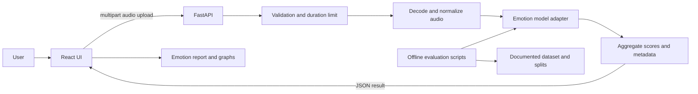

# Proposed Architecture and Design

**Status:** Initial design proposal
**Related requirements:** [`requirements.md`](requirements.md)

This document turns the SRS into an implementable first architecture. It records current proposals separately from choices that still need evidence or discussion. The first milestone is an offline, uploaded-file prototype; live streaming is deferred.

## 1. Architecture overview

Use a small client/server application:

- **Frontend:** React with JavaScript. Handles file selection, upload progress/status, errors, and rendering the analysis report.
- **Backend API:** Python with FastAPI. Validates uploads, coordinates decoding and preprocessing, calls the emotion model, and returns a structured result.
- **Audio pipeline:** SoundFile and Librosa for decoding/inspection and feature or waveform preparation, with an additional decoder such as FFmpeg when needed for formats like MP3. Decoder choice and installation requirements must be confirmed in a minimal spike.
- **Model layer:** A replaceable Python interface around a baseline model and, if justified, a pretrained/fine-tuned speech model. The API should not depend on a specific model implementation.
- **Evaluation artifacts:** Scripts/configuration and saved reports for dataset splits, metrics, and model comparisons. These are for development and reproducibility, not exposed as a public API.

For the first prototype, avoid a database and persistent audio storage unless a requirement emerges. Process the upload in a request, keep temporary data only as long as needed, and return the analysis. This simplifies privacy and operations, but means there is no history of previous analyses.



## 2. User request flow

1. The user selects an audio file. The UI displays its filename and submits it to the backend.
2. The frontend sends `multipart/form-data` to `POST /api/v1/analyze` and shows an analyzing state.
3. The backend checks that a file was supplied, applies an upload-size limit, verifies that it can be decoded, and determines its duration.
4. If the clip exceeds five minutes, the backend limits analysis to the first 300 seconds and records that truncation occurred. The response informs the UI, which displays the notice.
5. The audio adapter converts the clip to the model's expected sample rate, channel count, and numeric representation. These values belong to the chosen model configuration, not an assumption shared by every model.
6. The model adapter returns scores for the supported labels. The backend validates the output and formats the result.
7. The UI renders the predicted label, per-label scores, and agreed graphs. The UI identifies scores as model confidence/estimated scores and includes the SRS caveat that this is not a definitive reading of a person's feelings.
8. Temporary audio data is removed after processing, subject to the actual implementation and runtime behavior.

## 3. Proposed repository layout

```text
pbl/
├── docs/
│   ├── requirements.md
│   └── architecture.md
├── backend/
│   ├── app/
│   │   ├── main.py                 # FastAPI app and route registration
│   │   ├── api/routes/             # HTTP endpoints and request/response mapping
│   │   ├── schemas/                # Pydantic API schemas
│   │   ├── services/               # Analysis orchestration
│   │   ├── audio/                  # Decode, validate, truncate, normalize
│   │   └── models/                 # Model interface and implementations
│   ├── tests/
│   └── pyproject.toml or requirements.txt
├── frontend/
│   ├── src/
│   │   ├── components/             # Upload, status, report, graphs
│   │   ├── services/               # Backend API client
│   │   └── App.jsx
│   └── package.json
├── ml/
│   ├── configs/                    # Dataset/model/experiment settings
│   ├── scripts/                    # Training and evaluation entry points
│   └── README.md                   # Data setup and reproducibility notes
├── .gitignore
└── README.md
```

This is a proposed structure, not a requirement to create every directory immediately. Keep model experimentation separate from HTTP request handling so training code, model choices, or evaluation changes do not tangle with the web API.

## 4. API proposal

### `GET /api/v1/health`

Purpose: report whether the API process is running. It does not guarantee that a large model is loaded and ready unless we explicitly make it a readiness check.

Example response:

```json
{
  "status": "ok"
}
```

### `POST /api/v1/analyze`

Request: `multipart/form-data` with one `file` field. The server enforces a configured byte-size limit in addition to the five-minute decoded-duration limit.

Example response (illustrative; exact labels and fields can change with the model):

```json
{
  "analysis_id": "temporary-or-generated-id",
  "duration_seconds": 300.0,
  "analyzed_duration_seconds": 300.0,
  "truncated": true,
  "message": "The recording is longer than five minutes. Only its first five minutes were analyzed.",
  "model": {
    "name": "baseline-model",
    "version": "0.1"
  },
  "labels": ["anger", "happiness", "sadness", "neutral"],
  "scores": {
    "anger": 0.08,
    "happiness": 0.12,
    "sadness": 0.66,
    "neutral": 0.14
  },
  "predicted_label": "sadness",
  "disclaimer": "This is an estimate from vocal audio, not a definitive assessment of a person's feelings or a mental-health diagnosis."
}
```

The example omits frustration because it may not be represented by the selected dataset. The final response must only advertise labels the chosen model was trained and evaluated to predict. Scores should be described as model scores or confidence estimates; they are not automatically calibrated probabilities.

### Error response shape

Use a consistent JSON shape for expected client errors:

```json
{
  "error": {
    "code": "unsupported_audio_format",
    "message": "This audio format is not supported. Try one of the formats listed on the upload page."
  }
}
```

Proposed cases include missing file (`400`), unsupported format (`415`), too-large upload (`413`), unreadable/corrupt audio (`422`), and unexpected server/model failure (`500`). Avoid returning internal paths, stack traces, or sensitive implementation details to the client.

## 5. Audio processing design

The audio pipeline should make each transformation explicit and reproducible:

1. Enforce request byte limits before decoding to reduce resource-exhaustion risk.
2. Decode using a controlled library/toolchain; do not trust a filename extension as proof of file type.
3. Reject empty, malformed, or unsupported content with a stable error code.
4. Read duration and select the first 300 seconds when needed.
5. Convert channels and sample rate to the exact input contract of the selected model.
6. Check for non-finite samples and handle silence/near-silence intentionally.
7. Run inference and validate that the model returns finite scores for the configured labels.
8. Return analysis metadata and remove temporary files/buffers as practical.

**Format proposal for the first implementation:** MP3, WAV, and FLAC are candidates. Confirm decoder support and deployment setup before publishing them as supported. Container/codec combinations can vary, so validate actual decoding rather than relying only on extension or MIME type.

## 6. Model and evaluation boundary

Define a small model adapter contract, for example:

```python
class EmotionPredictor:
    def predict(self, audio, sample_rate: int) -> dict[str, float]:
        """Return finite scores for the configured emotion labels."""
```

Keep model loading separate from per-request prediction. The implementation may use an MFCC plus SVM baseline and compare it with a pretrained speech representation such as Wav2Vec2, as described in the project roadmap. Do not choose a winner based only on one score: record macro F1, per-class F1, confusion matrix, split strategy, runtime, and relevant limitations.

Evaluation data must be held out from training and tuning. Where the dataset has multiple recordings from each speaker, use a speaker-independent split if feasible to reduce speaker leakage. Dataset licensing, label definitions, class balance, and the meaning of any mappings (especially frustration) must be documented before interpreting results.

## 7. Frontend responsibilities

- Provide file picker and clear supported-format/length guidance.
- Prevent accidental duplicate submissions while a request is active.
- Show a loading state and useful error messages.
- Show a truncation notice when the backend reports `truncated: true`.
- Show the predicted label and a graph of per-label scores; select any additional time-based visual only if the model produces meaningful segment scores.
- Include the uncertainty/disclaimer language from the SRS.
- Treat backend scores as data, not as trusted HTML or executable content.

## 8. Security, privacy, and operational choices

- Do not persist uploaded audio by default. If temporary files are necessary, use a controlled temporary directory and delete them after analysis, including on failure paths.
- Configure upload size and processing limits; duration alone does not bound compressed file size or decoding cost.
- Do not log audio content or unnecessary personal data. Log operational errors and timing without recording the audio itself.
- Keep model and server configuration outside source code where appropriate.
- For this local prototype, document that uploaded audio is sent to the local backend and how it is handled. Revisit consent, retention, access control, and deployment security before using real customer recordings.

## 9. Design decisions and open questions

| Topic | Current proposal | Decision needed |
|---|---|---|
| Interaction mode | Uploaded files only | None for the first prototype; streaming is deferred. |
| Maximum analyzed duration | First 300 seconds | Confirmed by SRS. |
| Emotion labels | Anger, frustration, happiness, sadness; neutral if supported | Select dataset and map labels honestly. Frustration may need to be deferred. |
| Formats | MP3 plus candidates WAV and FLAC | Verify decoder and packaging support. |
| Model | Baseline then compare a pretrained speech model | Confirm with dataset suitability and compute constraints. |
| Graphs | Per-label score chart; optional segment chart | Decide whether the selected model supports meaningful segments. |
| Runtime target | Show progress; benchmark actual analysis time | Set a numeric target after choosing model and hardware. |
| Storage | No persistent upload storage | Confirm implementation can process safely in memory or clean temporary files. |
| Transcription | Not part of required prototype | Decide later whether it adds enough value. |

## 10. Implementation sequence

1. Confirm project assumptions and select a dataset/label strategy.
2. Create the repository skeleton, README, ignore rules, and Python/JavaScript dependency setup.
3. Implement and inspect a minimal audio decoding spike for the proposed formats, duration, truncation, and corrupt-file behavior.
4. Build a baseline evaluation pipeline and document its split and metrics.
5. Implement the model adapter and API response contract.
6. Build the React upload and report experience against the API.
7. Integrate, check the acceptance criteria, document setup and limitations, and benchmark on the intended hardware.

The sequence keeps early technical risks visible: dataset-label mismatch, audio codec support, and model runtime should be learned before the UI implies capabilities the backend cannot provide.
